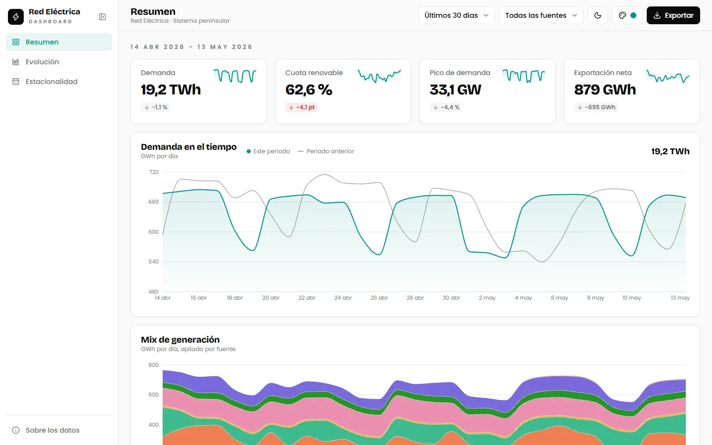

# Analytics Dashboard (Red Eléctrica)

Analytics dashboard for the **Spanish peninsular power grid**: demand, generation mix and international exchanges from 2008 to 2026.
Dense data at a glance: KPI row with sparklines, animated charts, shareable filters in the URL, CSV/PNG export, sortable table and offline support.

- **Vite 8** + **React 19** + **TypeScript 7** — static SPA, no backend.
- **Recharts 3** — area, stacked area, stacked 100 % bar, diverging bar, grouped bar and radar charts.
- **TanStack Table 9** — sortable sources table.
- **Tailwind CSS 4** — shadcn/ui-style tokens, light/dark mode and selectable primary color (teal by default).
- **DuckDB** (Python) — aggregates the raw dataset into a daily JSON.
- **vite-plugin-pwa** — installable, works offline with the dataset precached.
- **Fontsource** — self-hosted fonts; **modern-screenshot** — PNG export of each chart.
- **Vitest** + **Testing Library** — unit and component tests; **Playwright** — end-to-end tests on the production build.
- **pnpm** — package manager.

> Live demo: [hectorolisan.github.io/analytics-dashboard](https://hectorolisan.github.io/analytics-dashboard/)



## Screens

| Screen         | Charts                                                                                          |
| :------------- | :---------------------------------------------------------------------------------------------- |
| Resumen        | KPIs with sparklines, demand vs previous period, generation mix, sources table                  |
| Evolución      | Yearly generation mix (100 % stacked bars), yearly international balance, year vs year comparison |
| Estacionalidad | Month × year heatmap (demand / renewable share), demand by weekday, solar vs wind radar         |

- **Filters** live in the URL hash (`#/resumen?p=custom&from=…&to=…`, `#/evolucion?y0=2015&y1=2025&a=2015&b=2025`), so every view can be shared or bookmarked.
- **Resumen** offers fixed periods or a custom date range, always compared with the previous span of equal length. **Evolución** and **Estacionalidad** filter by year range.
- **Events** (lockdown 2020, storm Filomena, 2025 blackout) are marked on the time charts and the heatmap.
- **Export**: CSV of what each screen shows and a PNG button on every chart.

## Dataset

[**REE Iberian Peninsula Electricity Generation (2008–2026)**](https://huggingface.co/datasets/daniel-dona/ree-data) published on Hugging Face by `daniel-dona`, licensed under [**CC BY 4.0**](https://creativecommons.org/licenses/by/4.0/).

- **Source:** open data from [Red Eléctrica de España (REE)](https://www.ree.es/), collected from its API.
- **Content:** 1,931,443 records at 5-minute resolution (MW): demand, generation by technology (wind, solar, hydro, nuclear, combined cycle, coal, cogeneration…) and international exchanges.
- **Processing:** `scripts/build_dataset.py` aggregates the Parquet files with DuckDB into `public/data/ree-daily.json`: mean MW × 24 h = GWh/day, daily peak in MW.
- **Updates:** the Hugging Face snapshot stops on 2026-05-13. Later days come from the same 5-minute series in REE's demand API (`demanda.ree.es`, the source of the dataset), aggregated the same way. Before appending, the script re-fetches the last stored day and fails if it no longer matches.
- **Notes:**
  - Hydro is net generation, so it can be negative on pumping days.
  - A negative REE exchange balance means net export (checked against generation − demand).
  - Before 2015 REE groups solar thermal, biomass and cogeneration as _régimen especial_, so the renewable share for those years is underestimated.

> Data: © Red Eléctrica de España, via [`daniel-dona/ree-data`](https://huggingface.co/datasets/daniel-dona/ree-data) (CC BY 4.0) and REE's demand API. Aggregated daily; no other changes.
> The source code is under the [MIT License](./LICENSE); the data keeps its CC BY 4.0 license.

## Project Structure

```
/
├── public/
│   ├── data/
│   │   └── ree-daily.json      # Daily aggregates (generated)
│   ├── cover.webp
│   └── favicon.svg
├── scripts/
│   └── build_dataset.py        # Download + DuckDB aggregation
├── src/
│   ├── components/
│   │   ├── ChartTooltip.tsx    # Shared Recharts tooltip
│   │   ├── Credit.tsx          # Footer credit
│   │   ├── Dashboard.tsx       # Resumen screen
│   │   ├── DemandChart.tsx     # Demand vs previous period
│   │   ├── ErrorBoundary.tsx   # Per-screen render error fallback
│   │   ├── EventLines.tsx      # Event reference lines
│   │   ├── Evolution.tsx       # Evolución screen
│   │   ├── Filters.tsx         # Period, date/year range, source filters + CSV export
│   │   ├── Heatmap.tsx         # Month × year heatmap + Segmented control
│   │   ├── InfoDialog.tsx      # Dataset info dialog
│   │   ├── KpiCard.tsx         # KPI + sparkline
│   │   ├── MixChart.tsx        # Stacked generation mix
│   │   ├── SaveImage.tsx       # PNG download of the enclosing chart card
│   │   ├── Seasonality.tsx     # Estacionalidad screen
│   │   ├── Sidebar.tsx         # Collapsible sidebar (icon rail on desktop, sheet on mobile)
│   │   ├── Skeleton.tsx        # Loading skeletons
│   │   ├── SourceLegend.tsx
│   │   ├── SourcesTable.tsx    # TanStack Table
│   │   ├── ThemeControls.tsx   # Light/dark + primary color picker
│   │   └── YearCompare.tsx     # Year vs year monthly comparison
│   ├── lib/
│   │   ├── data.ts             # Day type, sources, loader
│   │   ├── events.ts           # Annotated events
│   │   ├── export.ts           # CSV rows per screen + downloads
│   │   ├── format.ts           # es-ES number/date formatting
│   │   ├── metrics.ts          # Periods, buckets, shares, averages
│   │   ├── route.ts            # Hash routing + URL params
│   │   ├── sidebar.ts          # Sidebar state + Ctrl+B
│   │   └── theme.ts            # Theme + primary color persistence
│   ├── App.tsx
│   ├── index.css               # Tailwind + design tokens
│   └── main.tsx
├── .github/workflows/      # CI, monthly data refresh, Pages deploy
├── e2e/                        # Playwright specs
├── AGENTS.md
├── index.html
├── LICENSE
├── package.json
├── playwright.config.ts
├── requirements.txt            # Python deps for the dataset script
├── vite.config.ts
└── README.md
```

## Available Scripts

| Command        | Action                                    |
| :------------- | :---------------------------------------- |
| `pnpm install` | Install all dependencies                  |
| `pnpm dev`     | Start dev server at `localhost:5173`      |
| `pnpm build`   | Type-check and build into `./dist/` (deployed to GitHub Pages after CI passes on `main`) |
| `pnpm preview` | Preview the production build              |
| `pnpm lint`    | Run Oxlint                                |
| `pnpm test`    | Run Vitest                                |
| `pnpm test:e2e` | Build, serve and run Playwright (`pnpm exec playwright install chromium` once) |

### Regenerate the dataset

```bash
python -m venv .venv
.venv\Scripts\activate        # Windows
source .venv/bin/activate     # Linux/macOS
pip install -r requirements.txt
python scripts/build_dataset.py          # appends new days from REE (stdlib only)
python scripts/build_dataset.py --full   # rebuilds the history from Hugging Face (needs DuckDB)
```

The `Data refresh` workflow runs it every Monday (or on demand) and commits the JSON when it changes, which triggers a new deploy.

> You can also use `npm` or `bun` if you prefer.
